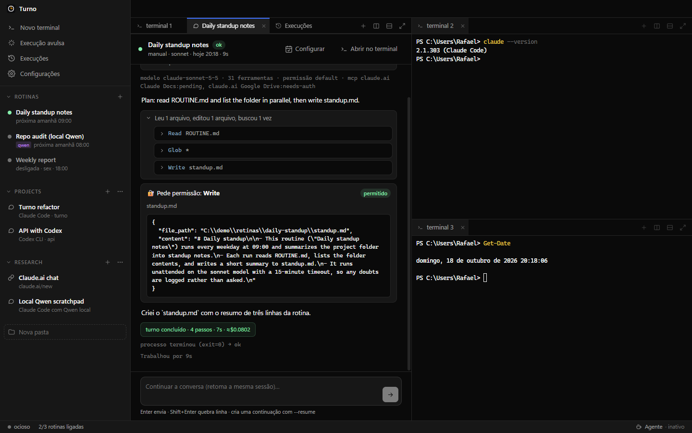
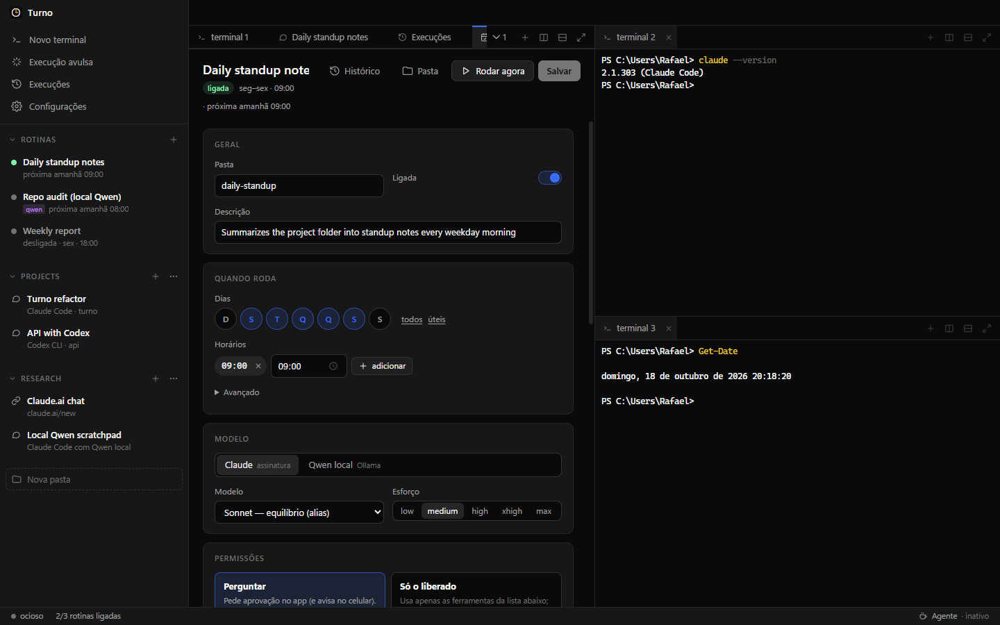
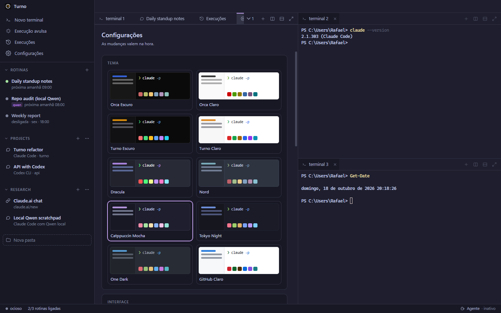

# Turno: scheduled AI agent routines on your own PC

**A Windows desktop app that runs your AI agents on a schedule, unattended, with Claude Code (your subscription) or a local model through Ollama. Every routine is a folder with a `ROUTINE.md`. You can open any run as a live chat with the agent, approve its tool calls from a card, and keep working next to it in split terminals. Local, free, MIT.**

[](https://github.com/eurafaeldecarvalho/turno/releases/latest)
[](https://github.com/eurafaeldecarvalho/turno/releases/latest)
[](https://www.electronjs.org)
[](https://www.typescriptlang.org)
[](./LICENSE)



```yaml
# ~/rotinas/daily-standup/ROUTINE.md
---
name: Daily standup notes
schedule:
  days: [seg, ter, qua, qui, sex]   # Mon–Fri
  times: ["09:00"]
profile: claude-max      # or qwen-local (Ollama)
model: sonnet
effort: medium
permission_mode: manual  # ask me: approval card in the app + phone push
---

Read the project folder and write standup.md with a three-line summary.
```

Turno does not implement an agent. It schedules and supervises the CLIs you already use: every run is `claude -p` speaking stream-json in both directions. That keeps the full Claude Code feature set (tools, skills, MCP servers, subagents, Claude in Chrome) and lets the same routine run on a local model by swapping the profile.

**Why this one:**

- **Runs when you are not looking.** Cron schedules with time zones, catch-up after sleep or reboot, timeouts, an idle watchdog, a clean `interrupt` before any kill, and named locks so two routines never fight over the same Chrome or GPU.
- **Talk to a routine while it runs.** Clicking a routine opens its run as a chat with thinking, grouped tool calls ("Read 3 files, ran 2 commands") and results. While the run is alive, a message goes straight into its stdin. Once it has finished, the message continues the same session with `--resume`.
- **You decide what it may do.** Five permission modes per routine, from *Ask* (an inline Allow / Allow for session / Deny card plus a phone notification) to *Bypass everything*.
- **Any model, one format.** Use your Claude subscription (Fable, Opus, Sonnet, Haiku) or `qwen3.6:35b` on Ollama with the same `ROUTINE.md`. Turno starts Ollama if it is down.
- **A real workspace.** xterm.js + ConPTY terminals in dockview: drag a tab onto another pane and drop it on the compass to split right or down. There are 10 themes, configurable fonts, a shell picker, and sidebar folders that reopen any Claude Code, Codex, Gemini, Qwen Code or OpenCode session in one click.
- **Plain files.** Routines are folders you can version in git. History is SQLite and every run keeps its raw event stream.

## Contents

- [Install](#install)
- [Quickstart](#quickstart)
- [Routine reference](#routine-reference)
- [The live chat](#the-live-chat)
- [Scheduling, locks and power](#scheduling-locks-and-power)
- [Workspace: terminals, folders, themes](#workspace-terminals-folders-themes)
- [Import from Claude Code Desktop](#import-from-claude-code-desktop)
- [How it works](#how-it-works)
- [Build from source](#build-from-source)
- [Alternatives: how it compares](#alternatives-how-it-compares)
- [FAQ](#faq)

## Install

1. Install [Claude Code](https://docs.anthropic.com/en/docs/claude-code) and log in once (`claude` → `/login`). For local models, also install [Ollama](https://ollama.com) and `ollama pull qwen3.6:35b`.
2. Download **`Turno-Setup-<version>.exe`** from the [latest release](https://github.com/eurafaeldecarvalho/turno/releases/latest) and run it.
   - The installer is not code-signed, so SmartScreen shows a warning. Click *More info → Run anyway*.
3. Turno opens and stays in the system tray. Closing the window only hides it, so routines keep running. Use *Quit* in the tray menu to stop everything.

> The interface is in Brazilian Portuguese. Routine files accept the Portuguese day names `dom seg ter qua qui sex sab` (Sun–Sat).

## Quickstart

1. Click **+** next to *Rotinas* in the sidebar.
2. Fill in the form: name, days and times, model, effort, permission mode, and the prompt.
3. Click **Criar rotina**. Turno creates the folder `~/rotinas/<id>/ROUTINE.md`, and editing that file by hand works too, because Turno watches the folder.
4. Press **▶ Rodar agora** to try the routine once. The run opens as a live chat.
5. When you are happy with it, turn it on (**Ligada**). It will run on schedule from then on.

## Routine reference

Every field can also be set in the routine editor (⚙ next to the routine).

```yaml
---
name: Daily summary
description: What this routine does
enabled: true
schedule:
  days: [seg, ter, qua, qui, sex]
  times: ["09:00", "18:30"]
  # cron: "15 9,12,15,18 * * *"     # advanced: replaces days/times
timezone: America/Sao_Paulo
profile: claude-max          # claude-max | qwen-local
model: sonnet                # fable | opus | sonnet | haiku | full id | "" = account default
effort: medium               # low | medium | high | xhigh | max
permission_mode: dontAsk     # manual | dontAsk | auto | acceptEdits | bypassPermissions
allowed_tools: ["Read", "Bash(python scripts/*)", "mcp__claude-in-chrome__*"]
chrome: false                # Claude in Chrome with your logged-in browser
locks: []                    # extra named locks; chrome and gpu are automatic
lock_policy: queue           # queue (wait up to 45 min) | skip
timeout_min: 60
idle_timeout_min: 15         # stop if the agent emits nothing for this long
catchup: true                # run the most recent missed slot once (PC was off/asleep)
catchup_window_h: 12
precheck: "python check.py"  # optional; non-zero exit = skip this run
notify: falhas               # falhas (failures) | sempre (always) | nunca (never)
---

Prompt. Be explicit: nobody is watching to answer questions.
```

| `permission_mode` | Shown as | What happens when the agent wants a tool that is not pre-approved |
|---|---|---|
| `manual` | Perguntar | An approval card appears in the chat and you get a notification. The run waits. |
| `dontAsk` | Só o liberado | Only `allowed_tools` run; everything else is denied silently. |
| `auto` | Auto | Claude Code's classifier approves safe actions and blocks risky ones. |
| `acceptEdits` | Aceitar edições | File edits are allowed; other tools not in the list are denied. |
| `bypassPermissions` | Ignorar tudo | Same as `--dangerously-skip-permissions`. |

## The live chat



- **Thinking** blocks are collapsed as *Pensou por 12s* (thought for 12s). Turno passes `--thinking-display summarized`, because without it thinking arrives empty in this mode.
- **Consecutive tool calls** are grouped into one sentence. Each call expands to its input and output, and failed calls are shown in red.
- **Messages sent during a run** are written to the live process stdin as stream-json `user` messages.
- **Messages sent after the run ended** start a continuation (`claude -p --resume <session>`) shown in the same thread.
- **Abrir no terminal** opens the interactive Claude Code TUI on that session.
- **Stop** sends a `control_request` interrupt first. If the process is still alive after 8 s, `taskkill /T` kills the whole tree (agent, MCP servers, Chrome helpers).

## Scheduling, locks and power

- **One cron per time slot** ([croner](https://github.com/Hexagon/croner)), with the routine's IANA time zone.
- **Catch-up** runs only the most recent missed slot, inside the window. It never runs slots from before the routine was turned on, so enabling a routine at 3 pm will not fire the 10 am slot.
- **Skipped runs are recorded with the reason:** previous run still going, lock busy, precheck failed, Claude not logged in, Ollama down.
- **Locks:** `chrome` is added automatically when `chrome: true`, and `gpu` for the local model.
- **Keep the computer awake** (status bar, bottom right):
  - *Ligado*: always awake;
  - *Agente*: awake only while an agent is working (the default);
  - *Desligado*: normal Windows power plan.

  It uses Electron's `powerSaveBlocker` and is re-applied after resume, like [Orca](https://github.com/stablyai/orca).
- **Notifications:** Windows toasts, plus optional push to your phone through [ntfy](https://ntfy.sh). They are suppressed while the window is focused and rate-limited per message.

## Workspace: terminals, folders, themes



- **Terminals:** xterm.js 6 with WebGL, search (Ctrl+F), clickable links, Unicode 11 and bracketed paste. Ctrl+Shift+C/V copy and paste, right click copies or pastes, and Shift+Enter inserts a newline in the Claude Code prompt.
- **Splits:** drag a tab onto another pane and pick a cell on the drop compass, use the split buttons in each pane header, or press Alt+Shift+= / Alt+Shift+-. The layout is saved between launches.
- **Sidebar folders** hold two kinds of items. You can collapse any section, including *Rotinas*.
  - **Agent chat** (Claude Code, Claude Code on local Qwen, Codex, Gemini CLI, Qwen Code, OpenCode or a custom command): clicking it opens that exact session in a terminal tab. For Claude Code you pick from your recent sessions (CLI and Desktop app), or Turno creates a fixed `--session-id` for a new one.
  - **Link** (claude.ai, ChatGPT, anything with a URL): opens in the browser or the registered app.
- **Settings:**
  - 10 themes: Orca Dark/Light, Turno Dark/Light, Dracula, Nord, Catppuccin Mocha, Tokyo Night, One Dark, GitHub Light;
  - UI font and size, picked from the fonts installed on the system;
  - terminal font, size, line height, weight, cursor, scrollback and default shell (PowerShell 7, Windows PowerShell, CMD, Git Bash, WSL are detected);
  - start with Windows and the ntfy topic.

| Shortcut | Action |
|---|---|
| Alt+Shift+= / Alt+Shift+- | Split right / down |
| Ctrl+Shift+T | New terminal |
| Ctrl+Shift+M | Maximize pane |
| Ctrl+Shift+W | Close pane |
| Ctrl+, | Settings |
| Ctrl+Shift+H | Run history |
| Ctrl+F | Search in terminal |

## Import from Claude Code Desktop

Claude Code Desktop keeps scheduled tasks as `~/.claude/scheduled-tasks/<id>/SKILL.md`. To bring them over:

```bash
python scripts/import-claude-desktop.py --schedules my-schedules.json
```

Every task is imported **disabled**, so nothing runs twice while the original is still on in Claude Desktop. Claude Desktop does not store the cron on disk, so you pass the times in a small JSON file. The script's docstring shows the format. Tasks without an entry are imported as manual-only.

## How it works

```
main process (Electron)
├── engine.ts    loads ~/rotinas/*/ROUTINE.md (zod), one croner job per slot, catch-up, locks, prechecks
├── runner.ts    spawn: claude -p --input-format stream-json --output-format stream-json --verbose
│                       --replay-user-messages --thinking-display summarized
│                       [--permission-prompt-tool stdio | --permission-prompts none] [--resume id]
│                prompt via stdin, events → %APPDATA%\turno\runs\<id>\, SQLite history
├── pty.ts       node-pty (ConPTY) for the terminals
├── awake.ts     powerSaveBlocker modes
└── tray, notifications (toast + ntfy), settings, sidebar folders
renderer (React 19 + dockview + xterm.js)
└── sidebar, chat view, routine editor, history, settings, status bar
```

- **Local Qwen** uses the same `claude -p`, with `ANTHROPIC_BASE_URL=http://localhost:11434` (Ollama's Anthropic-compatible endpoint) and the model set to `qwen3.6:35b`.
- **Data locations:**
  - history: `%APPDATA%\turno\turno.db`;
  - per-run raw events: `%APPDATA%\turno\runs\<id>\`;
  - settings: `%APPDATA%\turno\settings.json`;
  - sidebar folders: `%APPDATA%\turno\sidebar.json`.

## Build from source

```bash
pnpm install
pnpm dev          # run with hot reload
pnpm dist         # installer in dist\Turno-Setup-<version>.exe
pnpm dist:dir     # unpacked app in dist\win-unpacked\Turno.exe
pnpm smoke        # build, open a sample layout, save smoke/screenshot.png and exit
```

**Smoke flags** (they can be combined): `--smoke-run=<routine>`, `--smoke-followup="<text>"`, `--smoke-approve`, `--smoke-theme=<id>`, `--smoke-edit=<routine>`, `--smoke-wait=<sec>`.

**Testing without touching your real setup:** set `TURNO_ROUTINES_DIR` and `TURNO_USER_DATA` to point at test folders.

## Alternatives: how it compares

| | Turno | Claude Code Desktop routines | [Orca](https://github.com/stablyai/orca) | Cron + `claude -p` script |
|---|---|---|---|---|
| Runs with your Claude subscription | ✅ (official CLI) | ✅ | ✅ | ✅ |
| Local models (Ollama) per routine | ✅ | ❌ | indirect | manual |
| Runs with the window closed | ✅ tray | app must stay open | app must stay open | ✅ |
| Live chat with a running routine | ✅ | ✅ | ✅ | ❌ |
| Approval cards for tool calls | ✅ | ✅ | ✅ | ❌ |
| Locks between routines, catch-up, skip reasons | ✅ | partial | partial | ❌ |
| Split terminals | ✅ | ❌ | ✅ | ❌ |
| Routines as plain files | ✅ `ROUTINE.md` | `SKILL.md` + app state | app state | ✅ |

Orca is a full agent IDE (worktrees, diffs, a browser). Turno is narrower: it is built for agents that run unattended on a schedule. [`docs/`](docs) has the research behind the design, including a reverse-engineering study of Orca done with [REA](https://github.com/morluto/rea).

## FAQ

**Does it use my Claude subscription or API credits?**
Turno runs the official `claude` CLI that you are logged into, so it uses whatever that login uses. It never handles your OAuth token itself.

**Can a routine use my logged-in browser?**
Yes. Set `chrome: true` to give it Claude in Chrome (requires the claude.ai login). The `chrome` lock keeps routines from sharing the browser at the same time.

**Will a local model be as good as Claude?**
Not for long browser flows or many tool calls. Start local models on read-and-summarize routines.

**macOS or Linux?**
Not yet. The runner and the terminals are cross-platform, but process control (`taskkill`), shell detection and the installer are Windows-only for now.

## License

[MIT](./LICENSE) © Rafael de Carvalho
